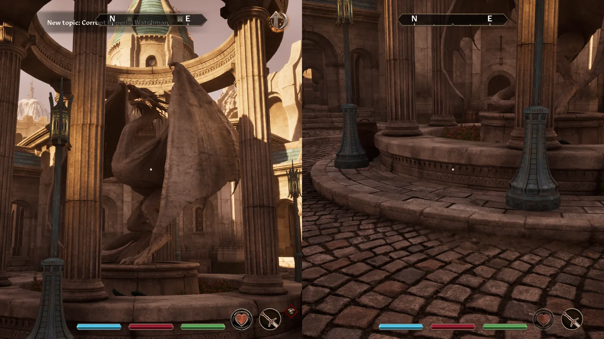
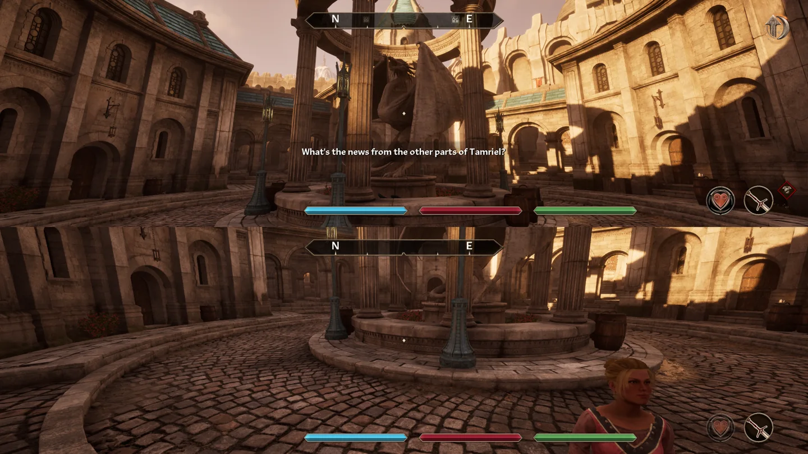

# Oblivion Remastered Local Split Screen

An experimental Windows mod for two players on one PC. Play side by side or stack Player 1 above Player 2. Both views have their own centered compass and reticle.

## Install the Windows preview

1. Close the game. This preview targets the Steam x64 build **1.512.105**. Start with a spare save slot.
2. [Download the Windows installer](https://raw.githubusercontent.com/jldx-1/oblivion-remastered-splitscreen-mod/main/docs/download/LocalSplitScreen-Setup.exe) and run it. It looks for the Steam installation and opens a folder picker if needed. The unsigned installer may show a Windows security prompt.
3. Launch the game normally from Steam, then connect two controllers.
4. Load your spare save. Open **System → Save & Load → Split Screen** with the mouse or controller. You can also press **Triangle** on the Save & Load page.
5. Choose Player 2's character and **Left / Right** or **Top / Bottom**. The controller used to open the menu is preselected for Player 1. Press **Options** on the other controller to start split screen. Reopen **Split Screen** to switch layouts or select **Unpair Controllers** to stop.

The [manual ZIP](https://raw.githubusercontent.com/jldx-1/oblivion-remastered-splitscreen-mod/main/docs/download/LocalSplitScreen-Windows.zip) contains the same files. Extract it and run its `Install.ps1` from an administrator PowerShell, with `-GameDirectory` if you need to specify the Steam game folder. [SHA-256 checksums](docs/download/SHA256SUMS.txt).

To disable the preview, close the game and change `LocalSplitScreen : 1` to `LocalSplitScreen : 0` in `OblivionRemastered\Binaries\Win64\ue4ss\Mods\mods.txt`. Your game saves and split-screen profiles are kept. Profiles and layout preferences live under `%LOCALAPPDATA%\OblivionRemasteredLocalSplitScreen`.

## Preview scope

Both layouts were checked in the game with simulated controllers. DualSense input goes through SDL. A simultaneous USB and Bluetooth controller playthrough is still pending. The public installer includes UE4SS and SDL, plus the mod. The separately built OBSE64 snapshot backend is required for per-player inventory panes and is unavailable in this package. Independent world travel and simultaneous NPC dialogue are still in development.

[Project site source](docs/index.html) · [UE4SS](https://github.com/UE4SS-RE/RE-UE4SS) · [SDL](https://github.com/libsdl-org/SDL)
